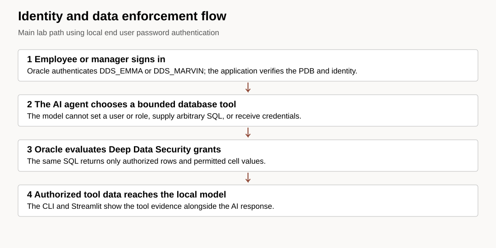

# Oracle Autonomous Database 26ai Deep Data Security

## About this Workshop

Build and present an end-to-end Deep Data Security demonstration. You will create
the database policies, run the same SQL as an employee and a manager, connect a
Python client for a Select AI Agent, and compare their results in a Streamlit web interface.

Estimated Workshop Time: 150 minutes after prerequisites and OCI access.
Allow another 45–90 minutes for the optional IAM and TCPS extension.

This workshop uses the folder, Markdown, manifest, and task conventions of the
supplied OCI Database Management sample. It is a custom workshop package and has
not been published in the Oracle LiveLabs catalog.

### Objectives

1. Create local DDS end users, conventional database roles, data roles, and data grants.
2. Enforce employee and manager row and cell permissions, including through a view.
3. Verify allowed and restricted SQL updates while restoring the original sample data.
4. Bind a Python agent to a database authenticated identity and inspect its tool results.
5. Show the active identity, submitted prompt, raw database results, and AI response in Streamlit.
6. Optionally attach a verified end user context through a trusted shared application account.

### Prerequisites

An existing Oracle Autonomous Database 26ai lab and local development tools are
required. Complete [Getting Started](../prerequisites/prerequisites.md) before Lab 1.

## The employee and manager scenario

Emma should see her own record and sensitive identifier and may edit her phone. Marvin should see himself and his two direct reports. He may edit team salaries, but their sensitive identifiers are hidden. Chris is outside Marvin’s team and must be invisible to both personas. Every record in this lab is synthetic.

The same broad SELECT is used for both users. Oracle evaluates the authenticated end user’s data grants before results reach Python or the model. The manager’s employee and manager authorizations combine: his employee role exposes his own full record, while his manager role exposes the permitted team columns. Review overlapping grants if the observed access is broader than expected. [Create data grants](https://docs.oracle.com/en/database/oracle/oracle-database/26/ddscg/create-data-grants.html), [Direct logon quick start](https://docs.oracle.com/en/database/oracle/oracle-database/26/ddscg/configure-oracle-deep-data-security-direct-logon-local-end-users.html)

| Record ID | Name | Login value | Manager value | Salary | Sensitive identifier |
| --- | --- | --- | --- | --- | --- |
| 200 | Marvin | DDS_MARVIN | NULL | 120000 | ID-DEMO-0200 |
| 300 | Chris | DDS_CHRIS | NULL | 95000 | ID-DEMO-0300 |
| 400 | Emma | DDS_EMMA | DDS_MARVIN | 80000 | ID-DEMO-0400 |
| 500 | Taylor | DDS_TAYLOR | DDS_MARVIN | 85000 | ID-DEMO-0500 |

The direct path is Streamlit or CLI → authenticated DDS end user → Select AI Agent RUN_TEAM in the same consumer session → invoker-rights PL/SQL tool → database data grants → authorized tool result → OCI Generative AI → answer. The model cannot supply a database identity or arbitrary SQL. The UI reads the actual session tool trace after the agent run.

The diagram shows the main direct-authentication path. The database establishes
the trusted identity and evaluates data grants before employee data reaches the model.

## Workshop contents

| Lab | Topic | Estimated time |
| --- | --- | --- |
| 1 | Prepare the workspace and target PDB | 10 minutes |
| 2 | Create users, data, roles, and data grants | 20 minutes |
| 3 | Demonstrate SQL access and verify rollback | 20 minutes |
| 4 | Configure Select AI Agent and Python | 35 minutes after OCI access |
| 5 | Ask the agent as each persona | 20 minutes |
| 6 | Present the Streamlit interface | 15 minutes |
| 7 | Optional explicit context propagation | 45–90 minutes |
| 8 | Rehearse, reset, and clean up | 10 minutes |

## Validation status

The release uses Select AI Agent with a configurable OCI Generative AI model. Earlier database probes established the expected employee and manager baseline. Live OCI-backed inference is pending participant configuration; see VALIDATION.md and AI_VERIFICATION.md for the required evidence. Offline tests use fake services and do not establish DDS enforcement.

You may now proceed to the next lab.

## Acknowledgements

- **Author** - Vivek Verma, Master Principal Cloud Architect
- **Last Updated By/Date** - Vivek Verma, Master Principal Cloud Architect, Nov 2026
