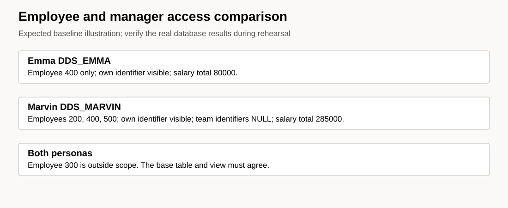

# Prove Employee and Manager Access with SQL

## Introduction

Compare authorized rows, hidden cells, and update permissions.

Estimated Time: 20 minutes.

### Objectives

- Compare identical queries, hidden cells, permitted changes, and denied changes.

### Prerequisites

This lab assumes the following are complete:

- Lab 2: Build the Database Security Model

## Task 1: Connect as Emma and run the employee tests

```sql
<copy>
CONNECT DDS_EMMA@DEMO_PDB
@sql/05_employee_demo.sql
</copy>
```

The helper displays active end user DDS_EMMA using JSON_VALUE on ORA_END_USER_CONTEXT. SHOW USER may report XS$NULL for an end user session; it is not the identity check used here. The broad query and view each return only this row:

```text
ID   NAME   SENSITIVE_ID   SALARY  PHONE
400  Emma   ID-DEMO-0400   80000   555-0400
```

The explicit employee 300 count is zero. Updating Emma’s phone to 555-0499 succeeds inside the transaction; ROLLBACK restores 555-0400. Attempting to set her salary to 999999 must leave salary 80000. Unauthorized column updates are documented as silently ignored, so check stored values instead of trusting an affected row count. If your release raises an unexpected error, the script exits and rolls back; inspect the error and verify the value as owner before continuing. [Fine grained data authorization](https://docs.oracle.com/en/database/oracle/oracle-database/26/ddscg/fine-grained-data-authorization.html)

Presenter explanation: “Emma submitted a broad query. Oracle returned her authorized record. Her role permits a phone correction but does not permit a salary change.”

## Task 2: Connect as Marvin and run the manager tests

```sql
<copy>
CONNECT DDS_MARVIN@DEMO_PDB
@sql/06_manager_demo.sql
</copy>
```

Expected identity is DDS_MARVIN. The same query and the view return:

```text
ID   NAME     SENSITIVE_ID   SALARY  PHONE
200  Marvin   ID-DEMO-0200   120000  555-0200
400  Emma     <NULL>         80000  555-0400
500  Taylor   <NULL>         85000  555-0500
```

Chris is absent. Marvin’s own identifier is visible via his employee role; team identifiers are NULL. The authorization check query should produce these logical values. Client BOOLEAN formatting may differ. [Access check functions](https://docs.oracle.com/en/database/oracle/oracle-database/26/ddscg/use-access-check-functions.html)

| Employee ID | Identifier display | May update phone | May update salary |
| --- | --- | --- | --- |
| 200 | ID-DEMO-0200 | TRUE | FALSE |
| 400 | Restricted | FALSE | TRUE |
| 500 | Restricted | FALSE | TRUE |

Emma’s salary becomes 81000 inside Marvin’s transaction and returns to 80000 after rollback. His attempt to change Emma’s phone must leave 555-0400. His attempt to change Chris’s salary is outside scope; the owner must still see 95000. ORA_IS_COLUMN_AUTHORIZED distinguishes a hidden value from an ordinary stored NULL. The display label does not implement the security policy. [Access check functions](https://docs.oracle.com/en/database/oracle/oracle-database/26/ddscg/use-access-check-functions.html)

## Task 3: Prove that authentication alone grants no employee data

```sql
<copy>
CONNECT DDS_OUTSIDER@DEMO_PDB
@sql/07_no_data_grant_demo.sql
</copy>
```

The identity check must succeed as DDS_OUTSIDER. Both queries must expose no employee values. Depending on the target release they may return no rows or an authorization error. This script temporarily continues SQL errors for those two negative tests. A failed login, syntax error, or network error does not prove policy enforcement.

## Task 4: Verify the baseline and inspect the grants

```sql
<copy>
CONNECT DDS_OWNER@DEMO_PDB
@sql/08_verify_baseline.sql
CONNECT SYS@DEMO_PDB AS SYSDBA
@sql/09_inspect_security.sql
</copy>
```

Expect all four original rows, original salaries and phones, and BASELINE_CHECK PASS. Inspect the populated synthetic identifiers too; masking did not erase them. The administrator inspection shows the intended end users, data role memberships, and three data grants. DDS_LOGIN_DB_ROLE has only CREATE SESSION and the object privilege query should show no ordinary table grants.

**Checkpoint** Emma sees one row, Marvin sees three, both miss Chris, team identifiers are hidden from Marvin, and every SQL update test has been rolled back. Keep these baseline values for the agent and UI labs.



This comparison is an illustration of the expected baseline, not captured output.
Inspect your actual SQL results and the owner baseline before proceeding.


You may now proceed to the next lab.

## Acknowledgements

- **Prepared for** - Vivek Verma
- **Format reference** - The supplied OCI Database Management sample workshop
- **Last Updated** - 22 November 2026
