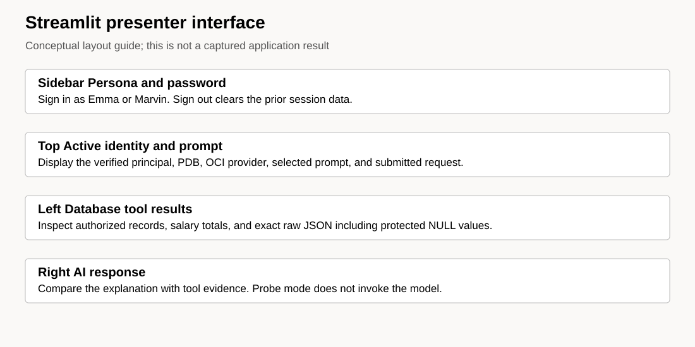

# Present the Streamlit Web Interface

## Introduction

Demonstrate identity, prompt, tool results, and AI response in the browser.

Estimated Time: 15 minutes.

### Objectives

- Show identity, prompt, tool results, and answer together and safely switch personas.

### Prerequisites

This lab assumes the following are complete:

- Lab 5: Ask the AI Agent as Each Persona

## Task 1: Launch the web interface

In the configured project root terminal:

```bash
<copy>
source .venv315/bin/activate
source config.env
python -m streamlit run streamlit_app.py
</copy>
```

Open http://127.0.0.1:8501 in your browser. The included .streamlit/config.toml binds to loopback and keeps CORS and XSRF protection enabled. Stop the server with Ctrl+C. This presenter UI uses direct local end user sign-in; the optional shared account mode is CLI only.

## Task 2: Demonstrate Emma

1. Select Employee · Emma in the sidebar, enter the DDS_EMMA password and the wallet password if configured, and click Sign in.
2. Confirm Active identity is DDS_EMMA and PDB matches your lab. The persona selector grants no access without the corresponding valid password.
3. Click Show database results. This fixed probe runs the table query, view query, employee 300 lookup, and salary summary without invoking OCI Generative AI. The Submitted prompt panel identifies the probe explicitly; the text box is not interpreted for this button.
4. Expect employee 400 only, own identifier visible, no employee 300, visible employees 1, and salary total 80,000. Expand Raw tool result and inspect the exact JSON.
5. Choose Show all employee records and salaries available to me and click Run AI agent. Read the Submitted prompt, Database tool results on the left, and AI response on the right.
6. Confirm the answer contains only values in the current authorized tool result. Repeat the employee 400 and employee 300 prompts.

## Task 3: Switch to Marvin and compare

1. Click Sign out and switch user. Confirm the old prompt, employee result, answer, and active login are cleared.
2. Select Manager · Marvin, enter DDS_MARVIN’s database password and the wallet password again, and sign in. Confirm Active identity is DDS_MARVIN.
3. Click Show database results. Expect IDs 200, 400, and 500, count 3, and total 285,000. Marvin’s identifier is visible; team identifiers display Restricted when the authorization flag is false.
4. Expand Raw tool result. Emma’s and Taylor’s identifiers must remain JSON null in both table and view. On the tested release, the view authorization flag can be true while these values stay NULL; compare the actual returned values. The UI display label does not replace the original database result.
5. Run the same natural language prompt and compare the answer with Emma’s. Then ask to show employee 400 including the sensitive identifier: Marvin may see her salary but must not receive her identifier.
6. Try the view and adversarial prompts from Lab 5. The active identity must stay DDS_MARVIN and Chris must remain outside scope.

## Task 4: Explain session behavior

Run AI agent calls the fixed DDS_OWNER.DDS_HR_TEAM through RUN_TEAM. The left panel shows the real tool trace from that consumer session; the right panel shows a response only after SUCCEEDED. The model is configured in DDS_OWNER.DDS_OCI_PROFILE. Show database results is a separately labeled diagnostic probe.

The app reauthenticates before every request, and the adapter verifies identity again before data SQL. Each browser session holds its own adapter and credentials in server memory; there is no global cached connection or employee result. Signing out clears that session’s credentials and display. Reauthentication failure signs the user out. A model or tool failure removes an old answer and retains only completed tool results from the current request. Raw exception text is hidden.

This local demo reuses lab passwords and is intended for a presenter’s computer. A deployed application needs an authenticated server side login and an appropriately trusted identity propagation flow. Do not turn the persona selector into an unauthenticated shared account identity switch.

**Checkpoint** You have compared both personas using SQL, a deterministic probe, a live AI answer, and the web UI. The database results agree in every path.

## Interface layout



This diagram describes the interface regions; it is not a screenshot of a live
database result. The app contains no canned employee answers or sample-data mode.


You may continue to the optional identity propagation lab or proceed directly to cleanup.

## Acknowledgements

- **Prepared for** - Vivek Verma
- **Format reference** - The supplied OCI Database Management sample workshop
- **Last Updated** - 23 November 2026
